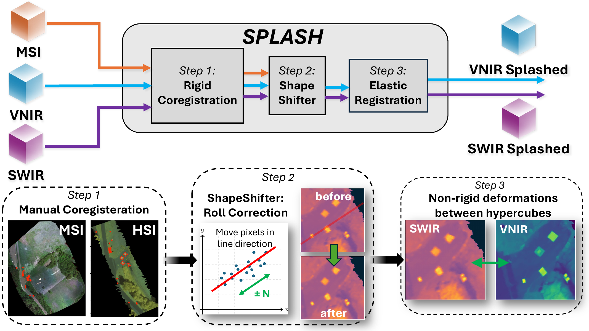

# GeoHarmony — SPLASH

SPLASH aligns georeferenced VNIR and SWIR pushbroom images using a multispectral
reference image. It combines three processing stages:

1. Manually selected correspondences fit a projective homography for each
   hyperspectral sensor relative to the multispectral reference.
2. ShapeShifter adjusts acquisition rows in both hyperspectral images.
3. ANTsPy SyN refines SWIR alignment to the corrected VNIR image.

[](docs/images/splash_highlevel.pdf)

[Download the workflow overview (PDF)](docs/images/splash_highlevel.pdf).

This repository provides a workflow for processing your own data, with a local
browser interface, a JSON configuration interface, and a generated synthetic
example. The synthetic example checks that the software runs; it is not an
accuracy benchmark.

## Install

Use a Conda environment to install the GDAL and ANTsPy dependencies:

```bash
git clone --branch splash-public https://github.com/amirhszd/geoharmony.git
cd geoharmony
conda env create -f environment.yml
conda activate splash
python -m pip install --no-deps -e .
geoharmony-splash --help
```

See [installation](docs/installation.md) for environment checks and a headless
setup. The documented environment has been checked on Linux; Windows and macOS
have not yet been validated. Model weights and GPU inference packages are not
required.

## Try the generated example

Choose a new directory for the example:

```bash
geoharmony-splash demo --output-dir /tmp/splash-demo
```

The command creates small synthetic inputs and a configuration, supplies known
homographies for those generated inputs, and runs the three processing stages
without requiring manual point selection. See the [example guide](examples/README.md).

## Process your own images

First read the [input preparation guide](docs/input-data.md). In particular, each
hyperspectral cube must include its original acquisition-row IDs as the last
band. Adding current image row numbers to an already orthorectified image does
not reconstruct acquisition-row provenance.

Launch the local setup interface:

```bash
geoharmony-splash
```

Or start from a portable configuration:

```bash
geoharmony-splash --config examples/config.json --validate-only
geoharmony-splash --config examples/config.json
```

Edit the example paths and band selections before using it. Paths in a JSON
configuration are resolved relative to that file's directory. All band
selections are zero-based, and range endpoints are inclusive.

An initial run opens point-selection and registration-preview windows. A later
headless run can reuse the saved homographies for the same inputs:

```bash
geoharmony-splash --config path/to/config.json --no-gui
```

Headless processing requires the two matching homographies and their input
metadata in the configured output directory. See the [interface guide](docs/gui.md)
for the full sequence and cache-reuse requirements.

## Outputs

The main outputs are ENVI rasters in `out_folder`:

- `vnir_splash` and `vnir_splash.hdr`: corrected VNIR on its original grid,
  without its auxiliary acquisition-row band.
- `swir_splash` and `swir_splash.hdr`: corrected SWIR on the VNIR grid, without
  its auxiliary acquisition-row band.
- `vnir_valid_mask` and `swir_valid_mask`, each with its `.hdr`: acquisition
  footprints, with 1 for valid support and 0 outside. Use these to distinguish
  valid spectral zeros from background.
- `resolved_config.json`: the resolved processing configuration.
- `run_metadata.json`: the run configuration, inputs, software versions and
  output records.

Intermediate products, saved models and transformation files are kept in
separate subdirectories. Keep each ENVI binary with its matching `.hdr` file.
Diagnostic difference images and deformation visualizations describe processing
changes; they are not calibrated positional uncertainty or an accuracy score.

## Documentation

- [Installation and environment](docs/installation.md)
- [Input data and acquisition-row preparation](docs/input-data.md)
- [Browser interface and headless runs](docs/gui.md)
- [Configuration and hyperparameters](docs/parameters.md)
- [Examples](examples/README.md)
- [Release and reproducibility notes](docs/releases.md)

The code is distributed under the [MIT license](LICENSE). Citation metadata for
the software is provided in [CITATION.cff](CITATION.cff).
